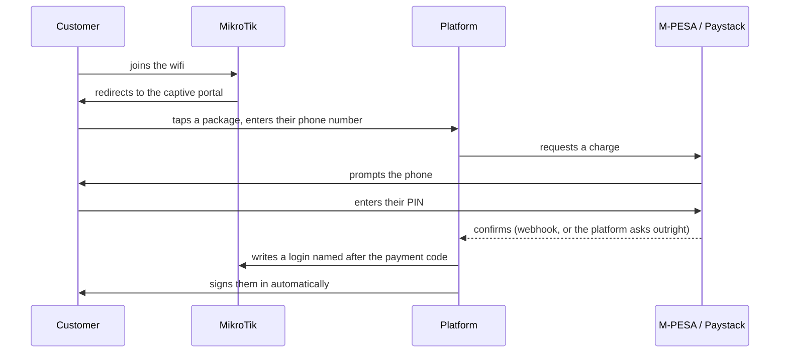

# ISP Management Platform

A multi-tenant billing and network-management platform for internet service providers running
MikroTik routers. Each tenant is an ISP with its own routers, packages, subscribers, payments
and reporting; the platform drives their hardware to match.

Two products sit inside it. **HotSpot** sells prepaid wifi to walk-ins who pay from their phone
and are online seconds later without typing a username. **PPPoE** manages fixed lines, where the
ISP creates the credentials and bills monthly.

---

## The idea it is built on

Business control and network control are separate, and neither pretends to be the other.

| Plane | Where it lives | What it owns |
|---|---|---|
| **Business** | Laravel | Tenants, customers, plans, payments, invoices, reporting |
| **Network** | The MikroTik | Authenticating users from its own local tables |
| **Control** | RouterOS API | Laravel writes users onto the device and deletes them when they expire |
| **Transport** | WireGuard | A private path to routers that sit behind NAT and cannot be dialled |

The consequence that matters: **the payment record is the truth, and the router is disposable.**
A HotSpot login is deleted from the device when the package is spent, but the payment stays —
which is what earnings are built from. A router reset to factory defaults loses its
configuration and nobody's money.

## What a sale looks like



The customer never chooses a username. Their M-PESA code **is** their username and password,
which means the confirmation SMS in their hand is enough to get back online later if anything
goes wrong — a router that was down, a phone that hopped to mobile data for the prompt, a closed
tab. The portal has a field for exactly that, and nobody is ever asked to pay twice.

Access is granted on a **confirmed result only**. A payment prompt being accepted just means the
provider agreed to ring the phone.

---

## Stack

| Concern | Technology |
|---|---|
| Application | Laravel 13, Livewire 4 + Flux, Fortify |
| Database | MySQL |
| Queue / cache | `database` locally, Redis in production |
| Router control | RouterOS API (`evilfreelancer/routeros-api-php`) |
| Router transport | WireGuard |
| Payments | Lipa na M-PESA (Daraja) and Paystack |

## Getting started

Requires PHP 8.3+, Composer, Node 20+, and MySQL.

```bash
git clone https://github.com/IsaacNyamari/mikrotik-billing-system-with-mpesa-and-paystack.git
cd mikrotik-billing-system-with-mpesa-and-paystack
composer install && npm install
cp .env.example .env && php artisan key:generate
```

Create two databases — `isp_platform` and `isp_platform_testing` — point `.env` at the first,
then:

```bash
php artisan migrate --seed
```

The seeders build the role and permission catalogue, which registration depends on — without it
`assignRole` fails and signing up 404s. They also create a development super admin
(`admin@isp.solforbs.com` / `password`) and, locally only, some demo data.

> [!WARNING]
> `--seed` is for development. That super admin is created in **any** environment, so never run
> it against production. Production is provisioned with the command below, which asks for the
> password rather than knowing it, and `deploy/release.sh` deliberately runs `migrate --force`
> with no seed.

```bash
php artisan platform:admin
```

Then run the app, and the scheduler beside it.

```bash
npm run dev
```

```bash
php artisan serve
```

```bash
php artisan schedule:work
```

The scheduler is **not optional**. Package expiry, payment reconciliation and router health all
ride on it, and without it packages never expire and payments sit pending forever.

## Working on it

```bash
composer test
```

Runs Pint, Larastan and PHPUnit together. Tests run against real MySQL rather than SQLite,
because the production target is MySQL and tenant isolation depends on real foreign-key and
index behaviour. Nothing in the suite touches a real router or a real payment provider — an
in-memory MikroTik and fake gateways stand in, and tests assert on what the device ends up
holding rather than on a list of calls.

Useful commands while developing:

```bash
php artisan router:test {slug}
```

```bash
php artisan plan:push {code} --router={slug}
```

```bash
php artisan hotspot:sweep --retry
```

```bash
php artisan payments:reconcile
```

## Adding a router

A router on somebody's broadband cannot be reached from the internet, so it cannot be configured
over the API — there is no API to reach yet. The platform generates a setup script that an
operator pastes into the device's own terminal once. It builds the WireGuard tunnel, an API user
bound to that tunnel and firewalled off everything else, the bridge, DHCP, the HotSpot, the
walled garden, the login pages and the wifi.

The order is a security property rather than a preference: the tunnel first, then the API bound
to it and firewalled *before* it is enabled. Opening the API first — even briefly — advertises an
admin service to the internet.

From then on the platform speaks to the device down the tunnel, and the router's address is its
tunnel address.

## Payments

Both providers sit behind one `PaymentGateway` contract, and each tenant chooses which to use.

Most ISPs have a till number and nothing else — obtaining Daraja credentials is a fortnight of
Safaricom paperwork. So **the platform's app signs the request and the ISP supplies only where
the money lands**, which is a distinction Safaricom itself draws between the shortcode that
authenticates and the party that gets paid. An ISP that already holds its own Daraja app keeps
using it.

Confirmation arrives two ways and both are believed, because both come from the provider: the
webhook it sends, and the answer it gives when asked. The second exists because a webhook only
arrives if the provider can reach the installation, which is not something to bet a customer's
purchase on.

## Deployment

There is no git remote on the server. `deploy/push.sh` sends the working tree over SSH and runs
`deploy/release.sh` there, so **what is on the development machine is what runs**.

```bash
./deploy/push.sh
```

```bash
./deploy/verify.sh
```

`verify.sh` hashes both sides and reports drift. It is worth running because `tar` overwrites and
adds but never deletes — a file removed locally stays on the server forever unless somebody
looks. `deploy/excludes.txt` is the single list of what is not source, read by both scripts.

A commit is not a deploy, and a deploy can carry uncommitted work. `git status` and
`./deploy/verify.sh` answer different questions.

## Project layout

```
app/
  Models/                  Domain: Tenant, Customer, ServiceAccount, Plan, Payment, Router…
  Services/
    RouterOs/              Everything that talks to a MikroTik, and the fake that stands in
    Mpesa/  Payments/      Collecting money, and settling it idempotently
    Provisioning/          WireGuard keys, tunnel addressing, the router setup script
  Support/
    Tenancy/               The tenant context, its facade, and the global scope
    Authorization/         The permission catalogue and the seven roles
resources/views/
  pages/portal/            The captive portal: no Vite, no Flux, styling inlined
  pages/docs/  docs/       The in-app manual
deploy/                    push, release, verify, and what counts as source
```

## Documentation

The manual lives inside the application, at `/docs`, rather than on a site somewhere — most of it
is wanted while a router is down or an account has lapsed, which is exactly when leaving is least
useful. It covers adding routers, the tunnel, packages, the portal, payments, getting a paid
customer back online, and a symptom-first troubleshooting chapter.

`CLAUDE.md` is the engineering companion: the decisions, the reasons, and the rules that are
defects to violate rather than style choices.

## Status

Delivered: multi-tenancy and authorization, customers and service accounts, the router domain and
RouterOS client, plans pushed to devices as profiles, HotSpot and PPPoE provisioning, the captive
portal, M-PESA and Paystack end to end, the WireGuard management network, earnings reporting, the
platform's own subscription billing, and production deployment.

Outstanding: vouchers, operational dashboards, and a security review.

## Licence

Proprietary. All rights reserved.
